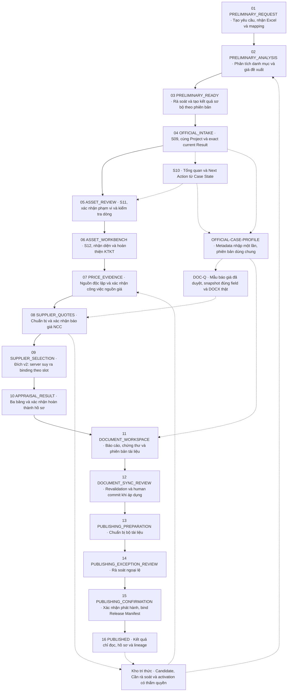
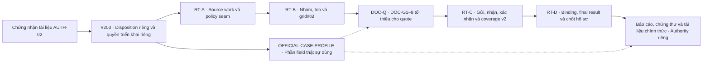

# OFFICIAL-CASE-PROFILE — thiết kế hợp đồng v1

**Tình trạng:** PO đã duyệt phạm vi S09/S10 trong kế hoạch. RUNTIME DOR NOT READY. Profile dùng cùng Project và cùng lineage với Official Intake. Dữ liệu S09 tùy chọn được bổ sung ở S10, với trường bắt buộc kiểm tại hành động thực sự sử dụng trường đó. S10 giữ vai trò điều phối và 16 stage canonical. Hợp đồng vật lý, quyền ghi, registry, numbering và mẫu thật còn chờ bằng chứng riêng.

[PO duyệt phạm vi](https://github.com/Reguluspt/valora-engineering/issues/252#issuecomment-7235813931) · [PM nghiệm thu inventory](https://github.com/Reguluspt/valora-engineering/issues/252#issuecomment-7236047164) · [Successor v1.2](../plan/VALORA_252_SUCCESSOR_ADR_DRAFT_v1.2.md) · [DoR và B06](../plan/VALORA_252_TECHNICAL_RECONCILIATION_AND_DOR_V1.md#open-blockers)

## Bằng chứng kế thừa

Inventory tại main 9dcc2a330497bd3970c4b04e8ec944ee0ac32397 có 46 dòng: 2 Đã có, 17 Một phần, 26 Chưa có, 1 Chưa đủ bằng chứng. [CI #718](https://github.com/Reguluspt/valora-engineering/actions/runs/46114377660) xác minh baseline, còn các PC01–PC14 là tiêu chí tương lai. AUTH-02 dùng lại bằng chứng kiểm tra tĩnh đã nghiệm thu. ZIP gốc được giữ byte-identical ở ngoài repo, SHA-256 566404da7a45b9754828daf3ba605094c63c114048d7f0a689513f9452182e7f, manifest 6/6. Phần [inventory](#ma-trận-46-trường-và-dữ-liệu-liên-quan-s09s10) và [ma trận PC](#6-acceptance-matrix-tương-lai--not-run) bảo toàn nội dung đã nghiệm thu.

## 1. Vòng đời và ranh giới thực tế

Các mã S09–S12 là màn hình/ngữ cảnh của thiết kế, còn 16 mã trong sơ đồ là canonical stages. Các đường nối là hướng nghiệp vụ đích; trạng thái và Next Action thực tế do server quyết định. Các nhánh nét đứt là ngữ cảnh hỗ trợ hoặc tái sử dụng có điều kiện. [D23](#d23) · [CS](#cs) · [CSS](#css)

| Đoạn | Hiện hành | Đích và điều cần bảo toàn |
|---|---|---|
| Pre-case đến S09 | OS-G1 đã chứng nhận. Project có thể chưa gắn Customer. Current batch, analysis và Result được chọn theo lineage. Bind một Customer ACTIVE cùng tenant là thao tác riêng trước human commit. Commit khóa đúng artifact/version/hash và giữ lịch sử Customer NULL có thật. | Phần profile điền sẵn nếu có và được bổ sung sau. Giữ cùng Project ID, không clone, không rebind bằng sửa snapshot và không lấy giá sơ bộ làm giá chính thức. [ADR](#adr) · [BIN](#bin) · [COM](#com) |
| S10 | Đọc projection có 16 stages, blockers, warnings, stale và next action. Header hiển thị tên Project. Resume/Activity hiện có placeholder tại surface được kiểm. | Header compact và thao tác Xem/Bổ sung thông tin hồ sơ dùng cùng profile với S09. Hiển thị thiếu field theo đúng việc cần dùng. Case State tiếp tục sở hữu stage và hành động tiếp theo. [OV](#ov) · [FES](#fes) · [FEN](#fen) |
| S11 và S12 | Guarded Apply sau Intake tạo exact initial-set seal, kiểm tra từng dòng và mở Workbench theo provider. Quyền thay đổi membership ngoài phạm vi đã chứng nhận vẫn theo contract riêng. | Giữ/thêm/loại/khôi phục theo thẩm quyền danh mục, bảo toàn raw Excel và kết quả sơ bộ đã lưu. S11 chốt danh mục, S12 làm rõ KTKT và nhận diện. Giá chính thức đi qua nguồn giá và xác nhận có thẩm quyền. [D11](#d11) · [ASR](#asr) · [VAL](#val) |
| Nguồn giá và NCCQ | Cap runtime v1 đến `SUPPLIER_QUOTES`. A9/A10/A13/A14 tiếp tục có hiệu lực, gồm tối thiểu một NCC đủ điều kiện theo exact line trong v1, retained source, currentness và human confirm. Sau COMPLETE là `NO_AUTHORIZED_DOWNSTREAM_ACTION`. | P252-01-T chốt công việc nguồn giá/công việc đơn giá trước NCCQ đích. P252-05 dùng đúng ba NCC cố định mỗi nhóm, exact lines, actual revision. Đề xuất và giá NCC không thay chứng cứ thẩm định. [R0](#r0) · [SQA](#sqa) · [NCC](#ncc) |
| Chọn NCC và kết quả | Hai stage canonical phía sau cap chưa được wire cho v1. Proposal per-line của ADR 0051 vẫn PROPOSED. | P252-04 giữ stage key và dùng server derive group × slot từ actual current proof, không thêm màn/chọn lại. P252-02 dùng một xác nhận toàn hồ sơ trong APPRAISAL_RESULT, ba bảng hiện hành, nguồn độc lập được chọn và coverage thủ tục tách riêng. Sau chốt chỉ sửa theo amend/reopen có thẩm quyền. [A15](#a15) · [PO sáu quyết định](https://github.com/Reguluspt/valora-engineering/issues/252#issuecomment-7235528474) |
| Tài liệu và phát hành | Có các nền tảng template metadata, mock render, retained bytes/DocumentRevision và M365 theo phạm vi riêng. Case State downstream vẫn NOT_AVAILABLE dưới cap. | Tạo báo cáo/chứng thư theo template và Data Snapshot, kiểm tra Managed Regions, chấp nhận revision rõ ràng, đồng bộ có revalidation/giải quyết xung đột. Phát hành bind exact accepted revisions trong Release Manifest; PUBLISHED là kết quả chỉ đọc. DOC-Q có thể phục vụ NCCQ trước các tài liệu chính thức nếu được cấp quyền hẹp. [D25](#d25) · [REG](#reg) · [R4](#r4) |
| Tích lũy Kho tri thức | Có authority design và các đường review theo domain riêng. Audit này không chứng nhận tự động nạp dữ liệu từ hồ sơ phát hành. | Dữ liệu hồ sơ/chứng cứ/định danh vào candidate theo pipeline có review, giữ nguồn gốc. Giá NCC chỉ từ actual confirmed exact revision, tái sử dụng phiên bản giá theo KB-01. Hỗ trợ tìm trong sơ bộ và nguồn giá; không thêm stage hoặc yêu cầu nhập lại ngày/tệp báo giá. [D25](#d25) · [KB](#kb) |

## 2. Đối chiếu thẩm quyền S09–S12

| Điều khoản | Điều đã chốt và điều còn hở |
|---|---|
| v2.2 §4.1–4.2, điều kiện chuyển | Giữ bố cục và hành vi tìm/prefill đã duyệt. ADR 0046 cụ thể hóa “có kết quả sơ bộ” thành exact **current** Result và Customer ACTIVE đã gắn trước commit. Bản sao thông tin Customer là lớp hiển thị/dữ liệu hồ sơ, còn ID pháp lý ở Project/Intake. Không sửa thuộc tính lịch sử hoặc master qua lệnh profile. |
| v2.2 §§4.3, 5, các trường ngoài danh tính | Giữ đủ nhóm mốc/số, giá trị/phí, nghiệm thu/thanh lý và nhân sự mặc định theo form gốc. Chưa điền thì hiển thị thiếu và cho bổ sung. Validate format/logic khi có giá trị. Mỗi blocker chỉ bật tại lệnh tiêu thụ đã có thẩm quyền khi cần field đó. |
| v2.2 §6 và v2.3 S10 | Giữ header profile, thông tin còn thiếu và nguồn Pre-case từ thiết kế S10. Tám checkpoint trình bày v2.2 là cách gom lịch sử. Runtime/đích v2.3 dùng 16 keys, progress và Next Action từ Case State. Bổ sung thông tin ở S10 là thao tác phụ đúng ngữ cảnh. |
| v2.2 §§7–8, S11/S12 | Giữ ý nghĩa chốt phạm vi và hoàn thiện KTKT. Dữ liệu thêm/loại theo design không được dùng để bỏ qua guarded Apply, exact sealed membership, A7/A8 hoặc quyền sửa membership. Profile metadata không sở hữu line price, mapping, review/validation hoặc kết quả. |
| v2.3 và successor v1.1 có câu “chờ P252-02/04” | Đây là trạng thái lịch sử tại lúc soạn. Quyết định PO sau đó đã duyệt cả sáu phương án target; không yêu cầu duyệt lại và không tự mở ADR 0051 hoặc runtime. Bản v1.2 ghi nhận quyết định đã duyệt, còn chứng nhận tài liệu và cấp quyền triển khai là các gate riêng. |

Nguồn đối chiếu · [D22](#d22) · [D11](#d11) · [INT](#int) · [D23](#d23) · [V11](#v11) · [PO v1.2](https://github.com/Reguluspt/valora-engineering/issues/252#issuecomment-7235528474)

### Sáu quyết định giữ nguyên

| Quyết định đã duyệt | Ràng buộc cho profile |
|---|---|
| P252-01-T-A | One human full-set working confirmation, current independent evidence và appraisal price. Profile metadata không làm phát sinh chấp nhận nguồn cuối. |
| P252-02-A | Một xác nhận toàn hồ sơ ở APPRAISAL_RESULT. Kết quả official lấy exact independent line×source và coverage NCC riêng. Tài liệu chấp nhận/phát hành ở authority sau. |
| P252-03-A | v1/v2 policy và epoch theo dossier, preview/adoption rõ ràng, atomic journal và item-local evidence với giữ quote-wide holds. Bổ sung profile không tự cutover hoặc sửa v1 facts. |
| P252-04-A | Giữ `SUPPLIER_SELECTION` và server-derived exact ordered three-slot binding. Profile không thêm checkpoint hay thao tác chọn lại. |
| P252-05-A | Exact partition và fixed distinct trio, reuse compatible history; P/105%/110% và giới hạn 115% chỉ cho nội bộ theo rule đã duyệt. Giá trả về thật và KB-01 giữ authority riêng. |
| P252-06-A | Chứng nhận AUTH-02 docs → disposition #203 riêng → runtime có quyền riêng. Bảo vệ #199. Giữ RT-A → RT-B → DOC-Q → RT-C → RT-D, hoàn tất phần field và registry tối thiểu đã xác minh cho từng consumer. |

[Chi tiết sáu phương án đã duyệt](https://github.com/Reguluspt/valora-engineering/issues/252#issuecomment-7235503421) · [Xác nhận PO](https://github.com/Reguluspt/valora-engineering/issues/252#issuecomment-7235528474)

## 3. Hợp đồng profile đề xuất

**Một hồ sơ, một owner cho mỗi giá trị.** Dùng cùng `organization_id + project_id` và liên kết Intake fact nếu đã commit. S09/S10 đọc cùng projection. Command bổ sung profile ghi metadata có phiên bản riêng. Document reader lấy các trường thực dùng từ đó và từ đúng domain owner, sau đó pin Data Snapshot. Template có format và locator, còn giá trị chính thức thuộc domain. Không yêu cầu nhập lại từng biểu mẫu.

### Vật chứng và interface tối thiểu cần đặc tả

| Thành phần | Đề xuất thiết kế | Điều phải duyệt trước runtime |
|---|---|---|
| Identity & lineage | Giữ `Project.id`, code và bound Customer ID do ADR 0046 sở hữu. Liên kết exact `intake_commit_id` / `result_artifact_id` khi có. Trường Pre-case đã chốt chỉ đọc. Snapshot Customer/Staff pin nguồn và phiên bản khi xem trước/chấp nhận profile, theo quyền hiện hành. | Xác nhận điểm pin snapshot lúc nào, thao tác hỗ trợ lưu draft trước S09 nếu dữ liệu nhập sớm, và cách truy lại snapshot đời trước. Intake payload và bind/replay hiện hành tiếp tục đúng contract. |
| Giá trị nhập | Dùng field typed theo nhóm customer, subject/purpose/note, milestones và tài chính. Ngày dân sự, mã/số văn bản dạng chuỗi giữ số 0; tiền decimal kèm currency và ngữ nghĩa. Vắng giá trị, clear có chủ ý và giá trị 0 là các trạng thái khác nhau. | Chốt semantic alias `Project.name`, `description`, `fee_amount`, `fee_currency_id` và `signer_profile_id`. Nếu alias trùng nghĩa, đọc cùng owner. Nếu khác, ghi nhận gap chuyển tiếp không dual write. Chốt kiểu thời điểm TĐ, decimal precision/currency, metadata riêng tư và numbering authorities. |
| Phiên bản | Mô hình vật lý ứng viên là metadata profile theo tenant/Project với revision append-only, đầu hiện hành xác định bằng predicate đã duyệt, parent/version, nguồn theo field khi cần, actor/audit/receipt. Bản legacy được read-through khi ngữ nghĩa đã xác minh, vắng nguồn thì hiển thị thiếu. | Duyệt storage, constraints, projection và chi phí đọc, quyền, backfill/rollout và rollback. Không kết luận chuyển hàng loạt, tự seed nhân sự, dùng 0 legacy làm giá trị đã nhập hoặc bắt buộc profile cũ đầy đủ. |
| Đọc và ghi | Read projection trả giá trị, nguồn, phiên bản và thiếu field theo consumer, phù hợp quyền đọc. Write logical: bổ sung/đính chính metadata với expected revision/CAS, tenant + Project scope, idempotency và xác nhận khi contract yêu cầu. Project-first lock, đọc lại quyền và dependence ở commit, append một fact/receipt/audit; replay trả đúng kết quả. | Duyệt endpoint/schema, scope permission hiện có có đủ hay không, concurrency với Bind/Intake, code mapping lỗi, pair dự thảo/official và policy amendments. Mặc định từ chối ở ngoài phạm vi; giữ review/approval một người, không xin grant từ báo cáo này. |
| Field Registry và fill | Mỗi Field ID ổn định khai báo owner, kiểu, nullability/cardinality, sensitivity, formatter version, tài liệu/region được phép, required-at-action và provenance. Compiler kết hợp role + exact Template Version + mapping + điều kiện; resolver tạo payload phía server. Manifest input pin exact version/digest các field thực dùng, table snapshot, source lineage, formatter và bytes. | DOC-G4/G5 và mẫu thực được duyệt để biết chính xác Field IDs, vị trí, mandatory/optional. Mock RenderJob nhận JSON sẵn không đủ làm provider hoặc xác nhận file. Kiểm tra exact template/locator/format, không tự dùng fallback để qua mandatory. |

**Chọn revision metadata riêng để bảo toàn lịch sử Intake và tài liệu.** Việc nhét toàn bộ profile vào payload Intake có thể làm dữ liệu tùy chọn cản chuyển hồ sơ. Duy trì một field cho mỗi biểu mẫu sẽ tạo nhập trùng và kết quả không đồng nhất. Đề xuất trên giữ việc ghi metadata ở đúng owner và giới hạn validation theo nơi sử dụng.

### Trạng thái thiếu và currentness

- Form S09 chọn Customer và chốt theo ADR 0046. Giá trị profile tùy chọn có thể bổ sung ở S09 hoặc S10 theo flow đã duyệt; nếu không có thì trả trạng thái thiếu. Mã hợp đồng, QĐ, chứng thư, hóa đơn giữ vắng mặt tới khi người có thẩm quyền cung cấp. No-op theo giá trị canonical không tạo thay đổi ngữ nghĩa.
- S10 hiển thị profile gọn và hành động bổ sung đúng trường. Thiếu tùy chọn là thông tin. Chỉ báo chặn ở đúng hành động có requirement được xác nhận bằng mapping hoặc quy tắc bên sở hữu. Không lấy số trường đã điền làm completion Case State.
- Giá trị dẫn xuất đọc từ cùng revision: tiêu đề theo subject, subject viết thường; ngày báo cáo = ngày chứng thư; ngày hợp đồng/chứng thư dạng chữ; chân trang từ thời điểm TĐ; dự kiến bắt đầu/kết thúc từ ngày hợp đồng/chứng thư. Giữ rỗng khi nguồn thiếu, formatter deterministic có version. Không nhân đôi input.
- Giá trị khai báo/tham chiếu, giá sơ bộ, phí, tổng thẩm định từ final result, giá NCC và giá đề xuất nội bộ là các nguồn tách biệt. Khóa đúng type khi mapping. Báo cáo sử dụng ba bảng và chính sách làm tròn/bằng chữ có thẩm quyền, không điền từ Project fee.
- Snapshot customer master copy theo field có thật, không suy người đại diện từ contact hoặc signer từ appraisal team. Khi đổi master/defaults, revision hồ sơ/tài liệu đã pin giữ nguyên. Xác nhận lại việc dùng bản mới theo authority nếu owner yêu cầu. Audit tránh lộ tài khoản ngân hàng và dữ liệu cá nhân ngoài người đọc được quyền.
- Phân biệt invocation CAS với semantic staleness. Legacy command có thể yêu cầu reload khi token/row_version thay đổi, còn stale của nguồn/quote đi theo exact dependency. A7/A8 digest hiện chứa giá trị line, gồm appraisal unit price. Source/quote còn có binding và thời hạn riêng. Profile command không đụng dữ liệu line, giữ các check đang có. [VAL](#val) · [PEA](#pea) · [SQA](#sqa)

| Thay đổi | Tác động đích đề xuất |
|---|---|
| Tên/chữ hiển thị, liên hệ, ngày/số văn bản, phí hoặc formatter | Invalidate candidate hoặc đánh dấu cần kiểm tra cho **tài liệu dùng đúng field đó**, theo danh sách Field ID thực dùng và digest. Candidate/preview có thể stale. Accepted DocumentRevision, sent bytes, actual quote, ReleaseManifest và các giá trị nghiệp vụ đã chốt giữ nguyên. Refresh/re-gen phải theo thao tác có thẩm quyền. |
| Mục đích / thời điểm thẩm định | Báo cáo/chứng thư dùng field đó cần xem lại. Chỉ reevaluate nguồn có điều kiện eligibility/dependency được định nghĩa rõ trong hợp đồng chủ quản. Trước khi có rule không tự suy cutoff hoặc loại nguồn. Nếu thực sự stale, xử lý nhánh source/working confirmation trước, giữ actual quote bytes và giá, áp dụng currentness đích theo sáu quyết định. |
| Dữ liệu ngữ nghĩa tài sản, số lượng, price, quote group/slot | Đây là thay đổi của owning domain, không phải profile metadata. Giữ A7/A8, price confirm và item-local/shared quote holds, exact membership, expected CAS và bảo vệ v1. Profile chỉ đọc và chuyển tín hiệu đã có quyền. |
| Chấp nhận revision hoặc phát hành rồi mới sửa | Giữ nguyên revision/version/signature/manifest đã bind. Nếu cần bản kế tiếp, tạo candidate và rà soát đúng flow revision/explicit accept, xử lý conflict Old/V/W và Managed Regions, thực hiện amend/release mới theo thẩm quyền. |

## 4. DOC-Q và các tài liệu chính thức

Sơ đồ dưới đây là thứ tự gói được duyệt về thiết kế. Profile được bổ sung để phục vụ các consumer thực tế của nó. Gói này không mở quyền bắt đầu stage hay DOC-G.

| Consumer | Input từ profile đề xuất dùng khi mẫu có mapping | Input thuộc domain khác và gate còn thiếu |
|---|---|---|
| DOC-Q/Phiếu đề nghị báo giá | Project/dossier reference để truy vết; subject/danh mục hoặc thông tin người yêu cầu liên quan nếu đúng mẫu Word đã duyệt. Chưa có mẫu vàng chứng minh field profile nào ngoài identity bắt buộc cho DOC-Q. | Nhóm/trio, exact asset set, specs/unit/quantity, supplier identity và draft request values từ RT-B. DOC-G1–8 hẹp cần real template, IR/locator, canonical Field ID, compile, actual fill/QA, version/custody. RT-C ghi actual sent/returned proof. Không lấy số/ngày CT hay hóa đơn làm blocker mặc định. |
| Hợp đồng, quyết định, thương thảo | Customer snapshot, subject, purpose, ghi chú khi có consent, số/ngày HĐ/QĐ, ngày thương thảo/dự thảo, phí/currency và điều kiện theo mẫu. | Role loại tài liệu, nguồn số/ngày, mẫu và retention/signed counterpart do document/contract authority. TD/TDS có danh mục và workflow thiết kế, chưa là field binding. |
| Báo cáo thẩm định | Customer hợp lệ, subject, purpose, appraisal time/footer, ngày BC từ ngày CT, số HĐ/QĐ/CT, điều kiện và người thực hiện nếu mẫu xác nhận. | Exact current final Result/three tables, independent evidence đã chấp nhận, exact grouped actual NCC binding cho Bảng 2, Managed Regions và approved Template Version. Không dùng giá sơ bộ hoặc phí thay tổng kết quả. |
| Chứng thư | Customer, subject, purpose và appraisal time, số/ngày CT, thông tin bên thực hiện theo mapping đã duyệt. | Final Result, thẩm quyền ký, location/managed regions, exact DocRevision và ReleaseManifest nếu phát hành. Số chứng chỉ cá nhân signer không cấp số CT hồ sơ. |
| Nghiệm thu, thanh lý, hóa đơn | Customer/đại diện, HĐ, giá trị/phí/currency đúng nghĩa, ngày thanh lý, tham chiếu số/ngày hóa đơn theo approved binding. | BB có thể không áp dụng. Chưa có căn cứ thêm số/ngày nghiệm thu riêng hoặc tích hợp xuất hóa đơn. Bản ký thuộc document custody riêng. |

Chi tiết nguồn · [REG](#reg) · [TD](#td) · [TDS](#tds) · [RPT](#rpt) · [CERT](#cert) · [Dependencies #255](https://github.com/Reguluspt/valora-engineering/issues/255#issuecomment-7235816616)

## 5. Definition of Ready · OFFICIAL-CASE-PROFILE

| # | Điều kiện | Tình trạng và điều kiện chuyển |
|---|---|---|
| 1 | Predecessor certified | **PASS baseline.** #718 xác nhận main đã kiểm. ADR 0046/OS-G1 là predecessor cho Intake. Từng slice cần bằng chứng sau cùng của package prerequisite tương ứng. |
| 2 | Authority accepted | **PASS kế hoạch, HOLD triển khai.** PO đã duyệt phục hồi scope S09/S10. Cần duyệt interface vật lý, authority field/mẫu, permission, #203 disposition và task riêng. |
| 3 | COMPLETE predicate known | **Đề xuất.** Đọc/sửa cùng profile version, field dùng được khi đúng owner/lineage và validator của action cần dùng pass. Không thêm stage complete. Exact required-at-action và source authority của từng template chưa chốt. |
| 4 | Mutation commands known | **Đề xuất.** Bổ sung profile và snapshot theo revision có confirmation/CAS/receipt/audit. Request/response, conflict resolution với Intake, khóa và error contracts chưa frozen. |
| 5 | RBAC disposition | **Ranh giới rõ, mapping HOLD.** Giữ quyền và same-tenant/session đang có. Phải chứng minh quyền chỉnh hồ sơ, đọc field nhạy cảm và document resolver riêng trước cấp runtime. |
| 6 | Currentness/stale rule | **Thiết kế có kiểm soát, HOLD chi tiết.** Dependency theo field thực dùng và exact revision. Chốt rule cho mục đích/thời điểm, văn bản được amend, formatter, nguồn default và digest/CAS theo command thực. |
| 7 | Downstream hold | **PASS ranh giới.** V1 cap SUPPLIER_QUOTES, #199/#203 protected. DOC-Q chỉ sau đúng dependency/authority riêng; profile không cần khai báo field phát hành đầy đủ ở S09. |
| 8 | API/read-model sufficient or gap bounded | **HOLD.** Đã xác định rõ existing Project/Customer/Intake/Case State và gap metadata/registry. Cần chọn projection/persistence, xử lý fee default 0, legacy name/description/signer aliases, typed fields và migration/rollback compatibility. |
| 9 | E2E acceptance matrix written | **PASS thiết kế, NOT RUN.** Ma trận PC01–PC14 bên dưới, cần fixture synthetic/mẫu Word và task test riêng. |
| 10 | Forbidden scope written | **PASS cho hồ sơ thiết kế.** Runtime, schema, migration và UAT cần quyền riêng. Bằng chứng đã nghiệm thu được giữ nguyên. |

### Blockers và effort

| Mức | Blocker | Hệ quả và điều kiện giải |
|---|---|---|
| Chặn handoff runtime | Disposition #203 chưa có, quyền task profile và DOC-Q chưa được cấp | Theo thứ tự đã chốt, chứng nhận tài liệu AUTH-02 trước. PO/Gate Owner xét bằng chứng UAT riêng, giữ #199. Scope profile và minimum DOC-G hẹp cần task riêng theo thứ tự đã duyệt. |
| Chặn đóng contract vật lý | Ownership, snapshot capture, aliases Project/Customer/config, exact decimal/currency, ngữ nghĩa thời điểm TĐ và số/ngày văn bản chưa đóng | Cần quyết định chung về typed properties, provenance, version, clear/null, legacy 0, source of numbering. Field tự chọn vẫn để trống; không đặt gate vì thiếu quyết định. |
| Chặn DOC-Q hoặc fill của từng loại tài liệu | Chưa có approved template fixtures, stable Field Registry/mapping và chứng thực DOCX thật | Chốt mẫu và bound field list cho DOC-Q trước, không đợi tất cả trường báo cáo/phát hành. Báo cáo/chứng thư cần final result, exact revisions và test riêng. |
| Chặn chứng nhận triển khai | Permission/CAS/receipt, test hồi quy Intake và snapshot/DocRevision chưa được chứng minh trên implementation | Chạy các case PC chỉ ở môi trường synthetic được phép, bảo toàn dữ liệu và evidence trước. |

Phần contract/indexing hiện tại là công việc tài liệu. Profile CRUD/snapshot và S09/S10 là effort **trung bình đến lớn**, rủi ro **HIGH/Product Authority** vì identity, số/mốc, phí và dữ liệu nhạy cảm. Mỗi consumer DOC-G4–8 thêm tích hợp template/managed regions và kiểm chứng byte thật. Chưa cam kết lịch.

## 6. Acceptance matrix tương lai · NOT RUN

| ID | Điều kiện và hành động | Kết quả phải chứng minh |
|---|---|---|
| PC01 | Pre-case chưa gắn Customer, có Result hiện hành và một Result cũ. Bind Customer thật cùng tenant, rồi Intake với exact phiên bản. | Cùng Project ID, một Intake fact, lineage/hash đúng, Result cũ/cũ do thay batch bị từ chối, lịch sử NULL giữ nguyên. S11 chốt phạm vi, giá sơ bộ vẫn là dữ liệu riêng. Đọc đối chiếu [UTI](#uti) · [UTF](#utf). |
| PC02 | Bind Customer inactive/cross-tenant/khác ID đã gắn; replay cùng key; commit dựa trên snapshot cũ hoặc mất phản hồi. | Deny/conflict đúng, cùng key/digest trả exact kết quả, không nhân fact/audit, không user khác đổi Customer qua profile. [COM](#com) · [UTC](#utc) |
| PC03 | Official Intake chỉ có dữ liệu bắt buộc hiện hành. Để trống các metadata tùy chọn, sau đó bổ sung trên S10. | Official Intake và Case State phản ánh đúng trạng thái, trường trống được ghi nhận nhưng không đặt gate chung. Cập nhật hợp lệ lưu một lần, invalid supplied value có feedback tại field. |
| PC04 | Prefill từ master, sửa địa chỉ/liên hệ trong hồ sơ, master sau đó đổi/có Customer hợp nhất theo luồng riêng. | Giữ snapshot/revision cũ và cùng identity. Không tự ghi ngược master, không đổi field của hồ sơ khác, cập nhật/reconciliation rõ khi quyền cho phép. |
| PC05 | Thử đọc/ghi profile, snapshot staff/bank và source từ tenant/role/session sai hoặc quyền bị thu hồi giữa preview/commit. | Chặn phía server, không rò rỉ field/PII qua projection, template, diagnostics hay audit. Không thêm quyền phê duyệt nhiều người. |
| PC06 | Điền subject, hợp đồng, chứng thư và appraisal time; trường nguồn trống, thêm mới, sửa và round-trip Unicode. | Tên/lowercase/date wording/footer/planned dates dẫn xuất đúng. Không có trường nhập trùng; nếu nguồn thiếu, hiển thị thiếu, ngày BC không lấy timestamp. |
| PC07 | Sửa ghi chú/liên hệ/fee; sau đó đổi mục đích/thời điểm ở dossier có nguồn bị ràng buộc thật và một dossier không có dependency. | Chỉ tài liệu dùng field bị stale. CAS có thể reload. Contract thực khai báo dependency mới chặn nguồn đúng phần. Giá chính thức và actual quote cũ giữ nguyên, recovery qua flow có thẩm quyền. |
| PC08 | Một hồ sơ đồng thời có giá sơ bộ, tổng khai báo, fee 0, fee chưa biết, giá NCC và tổng kết quả chính thức. | Type, currency, precision, authority và text/aggregate đúng từng tài liệu. Không lấy fee, preliminary hay NCC làm chứng cứ/giá chính thức. Mixed currency và imprecise value fail đúng scope đã duyệt. |
| PC09 | Mẫu DOC-Q chỉ cần phần profile tối thiểu; BC/CT cần trường khác, thêm case số/ngày chưa cấp hoặc Field ID/locator sai. | Quote tiếp tục khi đủ field của mẫu, vẫn bảo toàn NCCQ v2. BC/CT yêu cầu đúng trường sau, blocker có hướng điều hướng; không fabricate số/ngày hoặc fallback lách mandatory. |
| PC10 | Sinh hai mẫu thật cùng dùng một profile revision, rồi sửa một field chỉ mẫu thứ nhất dùng. Thử mapping sang vùng user-owned hoặc template version không phù hợp. | Hai mẫu lấy cùng source mà không nhập lại. Snapshot pin exact used values/formatter/revision/version; thay đổi chỉ ảnh hưởng tài liệu liên quan. DOCX có bytes/hash thật và không fill vùng ngoài authority. |
| PC11 | Thay mặc định thẩm định viên/trợ lý/phụ trách; cấu hình signer khác hoặc thiếu một vai không bắt buộc. | Profile cũ giữ nhân sự đã pin. Chọn lại/bổ sung theo authority của hồ sơ. Không kéo theo quyền ký, quyền phê duyệt hoặc gate S09. |
| PC12 | Sau khi accept rồi phát hành, profile đổi hoặc Word Working version quay về có conflict. | Accepted revision và Release Manifest immutable. Thay đổi chỉ tạo candidate/check cập nhật; revalidation, quyền amend và human accept riêng. Không tự ghi lại chữ ký/bản gửi/kết quả. |
| PC13 | S10 với profile thiếu, Case State đang có blocker thật hoặc sau cap hoàn tất. Kiểm tra điều hướng back/refresh. | Vẫn 16 stages và một primary Next Action do server. CTA profile phụ đến đúng nơi, cảnh báo thiếu tùy chọn không thay winner. Không sinh KSCL hay bước thứ 17. [UTO](#uto) |
| PC14 | Hai yêu cầu save đồng thời từ hai tab trên cùng revision hoặc replay sau timeout, lỗi audit/receipt/DB giữa transaction. | CAS từ chối bản cũ, một commit logic và outcome có thể xác minh; lỗi không để lại nửa profile, không đổi Intake/Result/quote; các chính sách v1/v2 và các quyền hiện hành giữ nguyên. |

## Ma trận 46 trường và dữ liệu liên quan S09/S10

### Cách đọc

Đối chiếu đúng SHA và cả năm lớp. Báo cáo đánh giá coverage cho đúng ngữ nghĩa S09/S10. **Đã có** là có bằng chứng xuyên các lớp phù hợp với vai trò của trường. **Một phần** là có lớp hoặc giá trị gần nghĩa nhưng thiếu luồng profile/snapshot. **Chưa có** là chưa thấy implementation đúng nghĩa trong phạm vi source đã kiểm. **Chưa đủ bằng chứng** dành cho field hoặc artifact mà mẫu, authority hoặc exact semantics chưa đủ để kết luận. Không suy luận dữ liệu tồn tại trên một database triển khai từ schema.

Mã nguồn như D22, DBP và FEM dẫn đến [đường dẫn và dòng tại exact SHA](#danh-mục-nguồn-cố-định). Q01–Q06 là phép tìm alias có trong EVIDENCE.json. Kết quả tìm và shape model/API/UI được dùng cùng nhau. Hiện trạng không kết luận từ một lần grep rỗng.

**REG/D0** · [DOC-G4 Data Model Registry](#reg) là roadmap. [Placeholder/binding](#ph) và [lưu binding path](#pb) là metadata theo template. [Mock RenderJob](#mock) ghi dữ liệu JSON đầu vào và hash, không chứng minh schema profile, Field ID chuẩn, real bytes hoặc approved field mapping. [Test Document Engine](#dtest) chỉ là static evidence về fixture và hash. [DocumentRevision](#drev) có nền tảng sở hữu revision riêng, không chứng minh đưa 46 trường vào DOCX. Tree kiểm tra không có Word golden template định dạng DOCX/DOTX/DOCM/DOTM. Mọi danh sách tài liệu sử dụng dưới đây là ứng viên cho mapping, không phải điều kiện bắt buộc đã phê duyệt.

**Đối chiếu tên gần giống** · `customer_snapshot` trong mapping chỉ là Customer ID kiểm tra đồng thời, chưa phải Customer profile. `certificate_number` của SignerProfile và `historical.appraisal_date` của nguồn giá có owner khác. [MAP](#map) · [DBS](#dbs) · [PES](#pes)

**Vai trò tài liệu** · HĐ = hợp đồng/phụ lục, QĐ = quyết định, BC = báo cáo, CT = chứng thư, BB = biên bản, HĐƠ = thông tin hóa đơn. PC01–PC14 dẫn đến [ma trận nghiệm thu](#6-acceptance-matrix-tương-lai--not-run). Trong cột owner, các hợp đồng metadata, Field ID và revision đều là đề xuất.

**Tổng hợp** · 2 đã có · 17 một phần · 26 chưa có · 1 chưa đủ bằng chứng.

### Identity và Customer binding

| ID / trường | Thiết kế v2.2 và authority | Coverage | Database / API / S09–S10 | Registry / Document Engine và tài liệu | Owner, cách đọc/ghi hoặc dẫn xuất và version đề xuất | Required-at-step | Acceptance |
|---|---|---|---|---|---|---|---|
| I01 · Project ID và cùng hồ sơ | [D22](#d22):130; [ADR](#adr):18–27 | Đã có | [DBP](#dbp), [DBI](#dbi): cùng Project; [API](#api) [BIN](#bin)/[COM](#com) kiểm chứng scope; [FEP](#fep) dùng đúng ID, S10 dùng resolved project. | Không phải trường in mặc định. Khóa tenant/Project xuyên Data Snapshot. | Project/Intake, bất biến. R/W qua lệnh identity hiện hành, profile chỉ đọc. | Gắn/Intake: bắt buộc theo ADR 0046. | PC01, PC02 |
| I02 · Mã hồ sơ | [D22](#d22):157 | Một phần | [DBP](#dbp) `code` unique theo tenant; [SPJ](#spj)/[APE](#ape) đọc, [APP](#app) không đổi mã; [FEM](#fem) đã hiển thị, [FES](#fes) thiếu cột mã profile. | [REG](#reg)/D0. Mã hồ sơ dùng nếu template đã duyệt yêu cầu. Mã khác số hợp đồng, QĐ, chứng thư, hóa đơn. | Project tiếp tục sở hữu; copy vào Data Snapshot ở phiên bản tài liệu. | Giữ mã hiện hành, không cấp lại tại S09. Điều kiện fill theo từng mapping. | PC03, PC10 |
| I03 · Customer ID đã gắn | [D22](#d22):90; [ADR](#adr):18–27,53–55 | Đã có | [DBC](#dbc)/[DBP](#dbp)/[DBI](#dbi) và [BIN](#bin)/[COM](#com) thực thi NULL → Customer ACTIVE cùng tenant, riêng trước commit; [FEB](#feb)/[UTF](#utf) xác nhận gắn; S10 không có profile editor. | Identity qua snapshot provenance; không phát tán UUID cho tài liệu người dùng nếu mapping không cần. | Customer master sở hữu danh tính; Project/Intake giữ đúng ID đã gắn. Profile chỉ tham chiếu. | Bắt buộc ở Official Intake hiện hành. Pre-case có thể chưa có. | PC01, PC02, PC05, PC14 |

### Customer snapshot

| ID / trường | Thiết kế v2.2 và authority | Coverage | Database / API / S09–S10 | Registry / Document Engine và tài liệu | Owner, cách đọc/ghi hoặc dẫn xuất và version đề xuất | Required-at-step | Acceptance |
|---|---|---|---|---|---|---|---|
| C01 · Chủ đầu tư / tên pháp lý | [D22](#d22):90–92 | Một phần | [DBC](#dbc) `legal_name`; [APC](#apc)/[SCC](#scc) đọc master. [FEB](#feb) ưu tiên `display_name` để xem nhanh, chưa có bản sao pháp lý riêng; [DBI](#dbi) chỉ chứa ID. | [REG](#reg)/D0. [DTEST](#dtest) `customer.name` là fixture placeholder, không chứng minh ánh xạ tên pháp lý. HĐ, BC, CT, BB tùy template. | Khởi tạo snapshot từ tên pháp lý đã kiểm tra, giữ tham chiếu bản nguồn. Sửa chữ trên hồ sơ có audit, địa chỉ hay tên không đổi ID đã gắn. | Customer binding theo I03, không thêm bắt buộc nhập snapshot ở Intake. Theo template của từng tài liệu. | PC03, PC04, PC10 |
| C02 · Mã số thuế | [D22](#d22):90–92 | Một phần | [DBC](#dbc) `tax_code`, [SCC](#scc)/[APC](#apc) đọc/tìm theo MST, [FEB](#feb) xem MST; không có cột snapshot chính thức [DBI](#dbi) hoặc field trong [SCI](#sci). | [REG](#reg)/D0. HĐ/BC/CT/BB/HĐƠ nếu được mapping, DOC-Q chỉ nếu template cần. | Profile snapshot từ master. Lưu chuỗi, giữ số 0 đầu và giá trị rỗng; đánh giá đổi thông tin nhận diện qua authority Customer hiện hành. | Tùy template và quy tắc hợp lệ của đơn vị, không dùng để tự đổi Customer. | PC03, PC04, PC10 |
| C03 · Số điện thoại | [D22](#d22):90–92 | Một phần | [DBC](#dbc)/[SCC](#scc) `contact_phone`, [APC](#apc) hỗ trợ search; [FEB](#feb) hiển thị read-only, chưa có profile snapshot. | [REG](#reg)/D0. HĐ/BB hoặc DOC-Q nếu golden template xác nhận cần liên hệ phía hồ sơ. | Profile snapshot từ master; giữ chuỗi. Trường liên hệ NCC thuộc bên NCC riêng. | Theo tài liệu sử dụng; không bắt buộc ở S09. | PC03, PC04, PC10 |
| C04 · Địa chỉ | [D22](#d22):90–92 | Một phần | [DBC](#dbc)/[SCC](#scc)/[APC](#apc) có `address` của master; [FEB](#feb) không hiển thị/sửa địa chỉ hồ sơ; [DBI](#dbi) không lưu địa chỉ. | [REG](#reg)/D0. HĐ, BC, CT, BB, HĐƠ tùy mẫu, liệu DOC-Q cần chưa đủ bằng chứng. | Profile snapshot từ master; bản hồ sơ độc lập, giữ phiên bản nguồn. | Theo template sở hữu. | PC03, PC04, PC10 |
| C05 · Tài khoản Chủ đầu tư | [D22](#d22):90–92 | Chưa có | [DBC](#dbc)/[SCC](#scc)/[DBI](#dbi) thiếu field tương ứng; [APC](#apc)/[FEB](#feb) không có snapshot tài khoản. Q01 kiểm tra alias qua lớp code. | [REG](#reg)/D0. HĐ/BB/HĐƠ nếu template và chính sách dữ liệu cho phép; DOC-Q chưa có yêu cầu. | Thông tin nhạy cảm trong profile snapshot. Prefill chỉ từ nguồn master đã được cấp thẩm quyền về sau. Ghi log thay đổi ở dạng đã che giá trị. | Chỉ khi mẫu và quyền đọc thực sự cần. Không ép bổ sung/tiết lộ sớm. | PC03, PC05, PC10 |
| C06 · Người đại diện | [D22](#d22):90–92 | Chưa có | [DBC](#dbc)/[SCC](#scc) có `contact_name`, chưa có trường người đại diện hồ sơ. [DBI](#dbi)/[SCI](#sci)/[FEB](#feb) thiếu write path. Q01. | [REG](#reg)/D0. HĐ/BB tùy mapping; có thể dùng ở BC/CT nếu mẫu đã xác nhận. | Profile snapshot, nhập hoặc prefill từ nguồn được duyệt. Tách người liên hệ và signer của VALORA. | Theo tài liệu sử dụng. | PC03, PC04, PC10 |
| C07 · Chức vụ người đại diện | [D22](#d22):90–92 | Chưa có | [DBC](#dbc)/[DBI](#dbi)/[SCC](#scc) không có chức vụ đại diện Customer. [DBS](#dbs) `title` là chức danh signer bên VALORA. [FEB](#feb) không có field này. Q01. | [REG](#reg)/D0. HĐ/BB tùy mapping. | Profile snapshot gắn với người đại diện cùng revision; giữ null khi chưa rõ. | Theo tài liệu sử dụng. | PC03, PC04, PC10 |
| C08 · Người liên hệ | [D22](#d22):90–92 | Một phần | [DBC](#dbc)/[SCC](#scc) `contact_name` có sẵn qua [APC](#apc); [FEB](#feb) chỉ hiển thị tên tổ chức/MST/SĐT, chưa có bản ghi contact snapshot. | [REG](#reg)/D0. HĐ/BB hoặc DOC-Q tùy mẫu và quyền. | Profile snapshot từ master, local override có audit riêng, không ghi ngược master. | Theo template. | PC03, PC04, PC10 |

### Thông tin hồ sơ

| ID / trường | Thiết kế v2.2 và authority | Coverage | Database / API / S09–S10 | Registry / Document Engine và tài liệu | Owner, cách đọc/ghi hoặc dẫn xuất và version đề xuất | Required-at-step | Acceptance |
|---|---|---|---|---|---|---|---|
| P01 · Tài sản thẩm định / tên danh mục | [D22](#d22):99–105,157 | Một phần | [DBP](#dbp)/[SPJ](#spj)/[APE](#ape) có Project.name; [FEM](#fem) và [FES](#fes) render tên Project. Chưa có subject độc lập đã map ngữ nghĩa với danh mục và quy tắc sinh title của S09. | [REG](#reg)/D0. Subject là ứng viên tối thiểu DOC-Q khi mẫu cần, và HĐ/BC/CT/BB. | Profile sở hữu subject string. Project.name là nhãn legacy, chỉ alias nếu PM xác nhận trùng nghĩa, không dual write. | S09 có thể bổ sung sau. Fill DOC-Q chỉ chặn nếu compiled template cần subject. | PC03, PC06, PC09, PC10 |
| P02 · Mục đích thẩm định | [D22](#d22):100,157 | Chưa có | Không có field đúng nghĩa trong [DBP](#dbp)/[SPJ](#spj)/[SCI](#sci). [FEM](#fem)/[FES](#fes) chưa hiển thị mục đích. Q02. | [REG](#reg)/D0. HĐ/BC/CT nếu mẫu đã duyệt, DOC-Q không có default requirement. | Profile sở hữu giá trị do người dùng xác nhận. Kiểu/tập giá trị hoặc free text còn cần owner duyệt. Chỉ ảnh hưởng eligibility khi authority khai báo dependency. | Gated ở tài liệu hoặc quy tắc nghiệp vụ có thẩm quyền cần nó, không chặn Intake. | PC03, PC07, PC10 |
| P03 · Ghi chú hồ sơ | [D22](#d22):101 | Một phần | [DBP](#dbp)/[SPJ](#spj)/[APP](#app) có `description`; [DBC](#dbc) có notes master khác phạm vi. [FEM](#fem) chỉ đọc code/name; [FES](#fes) thiếu profile note. Chưa xác định alias `description` == ghi chú S09. | [REG](#reg)/D0. Không in mặc định. Chỉ map nếu mẫu và người sở hữu authorize. | Một owner cho ghi chú, giữ Project.description nếu xác nhận trùng nghĩa. Phiên bản hóa phần chọn dùng tài liệu. | Tùy chọn; chỉ chặn nếu có contract cụ thể. | PC03, PC05, PC10 |

### Mốc và số hiệu

| ID / trường | Thiết kế v2.2 và authority | Coverage | Database / API / S09–S10 | Registry / Document Engine và tài liệu | Owner, cách đọc/ghi hoặc dẫn xuất và version đề xuất | Required-at-step | Acceptance |
|---|---|---|---|---|---|---|---|
| M01 · Ngày hợp đồng | [D22](#d22):110,115,144 | Chưa có | [DBP](#dbp)/[SPJ](#spj)/[SCI](#sci) không có ngày hợp đồng; [FEM](#fem) placeholder mốc và [FES](#fes) không có. Q02. | [REG](#reg)/D0. HĐ/BB, BC/CT nếu tham chiếu. DOC-Q dùng chỉ khi mẫu quotation thật cần. | Profile date, lấy từ hợp đồng đã xác minh nếu có. Giữ ngày dân sự theo hợp đồng, không suy từ ngày hệ thống. | Theo mẫu HĐ/BC/CT/BB đã duyệt. Có thì kiểm format/logic đã có authority. | PC03, PC06, PC09, PC10 |
| M02 · Số hợp đồng | [D22](#d22):110 | Chưa có | [DBP](#dbp)/[SPJ](#spj)/[SCI](#sci) không có; [FEM](#fem) placeholder; mã Project không thay số hợp đồng. Q02. | [REG](#reg)/D0. HĐ, QĐ, BC, CT, BB và DOC-Q nếu template cụ thể yêu cầu. | Profile opaque string, nguồn và cách cấp số theo owner hợp đồng, không sinh từ Project ID. | Chỉ ở tài liệu tiêu thụ sau khi cách cấp/validation đã duyệt. | PC03, PC09, PC10 |
| M03 · Số quyết định | [D22](#d22):110 | Chưa có | [DBP](#dbp)/[SPJ](#spj)/[SCI](#sci)/[FEM](#fem) không có số văn bản này; ID `Decision` trong decision/audit không cùng nghiệp vụ. Q02. | [REG](#reg)/D0. QĐ và tài liệu dẫn chiếu theo mapping; chưa đủ chứng cứ vị trí placeholder. | Profile reference string hoặc đọc owner document number nếu có contract, phục vụ một nguồn duy nhất. | Theo QĐ hoặc tài liệu thực sự có tham chiếu. Quy tắc cấp số còn mở. | PC03, PC09, PC10 |
| M04 · Ngày chứng thư | [D22](#d22):111,115,145 | Chưa có | [DBP](#dbp)/[SPJ](#spj)/[SCI](#sci) thiếu mốc, [FEM](#fem) placeholder. Created/updated timestamps không thay ngày CT. Q02. | [REG](#reg)/D0. CT và BC thông qua ngày báo cáo dẫn xuất. DOC-Q không yêu cầu mặc định. | Profile date theo thẩm quyền CT; dẫn xuất chỉ từ giá trị thực. | Cần khi CT/BC dùng field đó; không chặn S09/DOC-Q vì chưa có. | PC03, PC06, PC09, PC12 |
| M05 · Số chứng thư | [D22](#d22):111 | Chưa có | [DBS](#dbs)/[SIG](#sig) `certificate_number` là của signer, không phải số CT hồ sơ. Không thấy field tương ứng trong [DBP](#dbp)/[SPJ](#spj)/[SCI](#sci)/[FEM](#fem). Q02. | [REG](#reg)/D0. CT và BC có tham chiếu CT tùy mẫu. Không thuộc DOC-Q mặc định. | Profile reference hoặc registry số CT do owner CT quản lý nếu được phê duyệt. Ứng viên string opaque. | Theo CT/BC hoặc release checks được duyệt. Chưa quyết định thời điểm/cơ chế cấp số. | PC03, PC09, PC10, PC12 |
| M06 · Thời điểm thẩm định | [D22](#d22):111,115,157 | Chưa có | [DBP](#dbp)/[SPJ](#spj)/[SCI](#sci)/[FEM](#fem)/[FES](#fes) không có mốc của hồ sơ; [PES](#pes) `historical.appraisal_date` là ngày của nguồn hồ sơ cũ. Q02. | [REG](#reg)/D0. BC/CT và chân trang nếu mẫu cần. Không mặc định dùng cho DOC-Q. | Profile dùng ngữ nghĩa thời gian đã duyệt. PM cần chốt date/period/timezone trước physical interface. Ghi nhận dependency chỉ khi luật nguồn thật sự dùng mốc. | Theo bước dùng thật và authority cụ thể. Không thay bằng ngày chứng thư hoặc lịch hệ thống. | PC06, PC07, PC10 |
| M07 · Ngày thương thảo | [D22](#d22):112 | Chưa có | [DBP](#dbp)/[SPJ](#spj)/[SCI](#sci) không có, [FEM](#fem) placeholder. Q02. | [REG](#reg)/D0. Biên bản thương thảo, HĐ hoặc tham chiếu QĐ nếu mẫu yêu cầu. | Profile date, nguồn chứng từ hay nhập xác nhận theo owner từng bước. | Theo mẫu sử dụng, không tự sinh từ ngày hợp đồng. | PC03, PC09, PC10 |
| M08 · Ngày dự thảo | [D22](#d22):112 | Chưa có | [DBP](#dbp)/[SPJ](#spj)/[SCI](#sci)/[FEM](#fem) thiếu mốc ngày dự thảo nghiệp vụ; `created_at` tài liệu là timestamp kỹ thuật. Q02. | [REG](#reg)/D0. Dự thảo HĐ hoặc tài liệu có field này trong mẫu được xác nhận. | Profile date theo ngữ nghĩa v2.2; không dùng timestamp mock render. | Chỉ ở mẫu sử dụng. | PC03, PC09, PC10 |

### Giá trị, điều kiện và phí

| ID / trường | Thiết kế v2.2 và authority | Coverage | Database / API / S09–S10 | Registry / Document Engine và tài liệu | Owner, cách đọc/ghi hoặc dẫn xuất và version đề xuất | Required-at-step | Acceptance |
|---|---|---|---|---|---|---|---|
| V01 · Tổng giá trị khai báo / tham chiếu | [D22](#d22):120,157 | Chưa có | [DBP](#dbp) có phí; [PRE](#pre) có giá và thành tiền sơ bộ theo dòng. Không có field tổng khai báo chính thức trong [DBP](#dbp)/[SPJ](#spj)/[SCI](#sci), [FEM](#fem) placeholder. Q03. | [REG](#reg)/D0. HĐ/BB nếu đúng mục đích ghi nhận giá trị tham chiếu; không thay `Tổng cộng` trong BC/CT. | Profile amount + tiền tệ, kèm nguồn/ngữ nghĩa tham chiếu. Giữ vắng mặt khác 0, không tự lấy tổng sơ bộ. | Theo mẫu cho phép dùng tổng khai báo. Chặn nhầm loại dữ liệu thay vì suy số từ field khác. | PC03, PC08, PC10 |
| V02 · Tổng kết quả thẩm định chính thức | [D25](#d25):195–210; [R0](#r0):309–322 | Một phần | [DBL](#dbl) và Workbench có đơn giá/currency theo dòng; [FES](#fes) không có aggregate chính thức; [CS](#cs) đặt APPRAISAL_RESULT ngoài cap. Chưa có fact tổng final qua [API](#api) S09/S10. | [REG](#reg)/D0. BC/CT từ final result snapshot, bảng/cột, tổng/làm tròn/bằng chữ theo baseline. DOC-Q không dùng tổng đã final. | Result domain sở hữu computed total từ exact line decisions và policy được duyệt. Profile tham chiếu read-only, không nhận giá nhập tay thay aggregate. | Theo APPRAISAL_RESULT và BC/CT chính thức sau authority riêng. | PC08, PC10, PC12 |
| V03 · Giá đã bao gồm / điều kiện giá | [D22](#d22):120 | Chưa có | [DBP](#dbp)/[SPJ](#spj)/[SCI](#sci)/[FEM](#fem) thiếu field profile. Quote terms A13 có authority riêng, không áp sang điều kiện giá hồ sơ. Q03. | [REG](#reg)/D0. HĐ/BB/BC/CT theo nghĩa đúng của mẫu. DOC-Q terms thuộc quote/request owner. | Profile text hoặc structured terms đã đóng bộ giá trị. Nguồn do người dùng xác nhận, không suy VAT/thuế/vận chuyển. | Theo tài liệu thực sự dùng field. Chưa đủ rule về cấu trúc điều kiện. | PC03, PC08, PC10 |
| V04 · Phí thẩm định | [D22](#d22):121 | Một phần | [DBP](#dbp) Numeric(15,2) default 0, [SPJ](#spj) dùng float, [APP](#app) đọc/sửa có row_version; S09 [FEM](#fem) và S10 [FES](#fes) chưa có UI profile. Phân biệt legacy 0 và chưa nhập chưa có proof. | [REG](#reg)/D0. HĐ/BB/HĐƠ nếu mẫu cần phí; phí không điền thành giá tài sản hoặc báo giá [NCC](#ncc). | Giữ một owner. Chốt reuse fee_amount nếu đúng nghĩa, typed decimal + trạng thái hiện diện theo contract. Không tự đổi dữ liệu legacy. | Gated khi mẫu đúng loại cần phí. Chốt currency/precision trước rollout. | PC03, PC08, PC10, PC14 |
| V05 · Tiền tệ phí | [D22](#d22):117–122; PO 7235813931 §1 | Một phần | [DBP](#dbp) `fee_currency_id` nullable FK, [SPJ](#spj)/[APP](#app) đọc/sửa. [FEM](#fem)/[FES](#fes) chưa cho thấy currency của phí. [DBL](#dbl) currency thẩm định khác. | [REG](#reg)/D0. Đồng hành với phí trong HĐ/BB/HĐƠ tùy mẫu. DOC-Q tiền tệ của quote riêng. | Cùng owner và revision với fee; chỉ bind currency hợp lệ. Không lấy VND hay currency của giá tài sản làm default tự động. | Chặn phép hiển thị/tính phí ở mẫu nếu số tiền có mà currency bắt buộc chưa rõ. | PC03, PC08, PC10 |

### Nghiệm thu, thanh lý và hóa đơn

| ID / trường | Thiết kế v2.2 và authority | Coverage | Database / API / S09–S10 | Registry / Document Engine và tài liệu | Owner, cách đọc/ghi hoặc dẫn xuất và version đề xuất | Required-at-step | Acceptance |
|---|---|---|---|---|---|---|---|
| A01 · Biên bản nghiệm thu và mốc riêng nếu có | [D22](#d22):124–128; [TD](#td):33–45 | Chưa đủ bằng chứng | v2.2 có nhóm `Biên bản nghiệm thu & thanh lý`; không liệt kê ngày/số nghiệm thu riêng. Có metadata ProjectFile category và workspace, chưa thấy fact nghiệm thu profile hoặc signature proof. Q04. | [TD](#td) ghi nhận loại BB nghiệm thu. [REG](#reg)/D0, không có golden template và locator được kiểm chứng. | Document owner giữ tài liệu/retained revision. Chỉ khai báo field/mốc riêng sau khi mẫu+authority xác định chính xác. | Ở luồng nghiệm thu nếu có, không tự thêm gate hay ngày/số bắt buộc tại S09. | PC03, PC10, PC12 |
| A02 · Ngày thanh lý | [D22](#d22):127 | Chưa có | [DBP](#dbp)/[SPJ](#spj)/[SCI](#sci)/[FEM](#fem) thiếu field; type/tên file không chứng minh ngày nghiệp vụ. Q04. | [REG](#reg)/D0. BB thanh lý trong [TD](#td), chỉ fill khi mẫu thật có binding. | Profile date nhập/đọc từ hồ sơ thanh lý theo owner đã duyệt, retain source. | Chỉ tại tài liệu sử dụng, không gate DOC-Q. | PC03, PC09, PC10 |
| A03 · Số hóa đơn | [D22](#d22):127 | Chưa có | [DBP](#dbp)/[SPJ](#spj)/[SCI](#sci)/[FEM](#fem) thiếu field. Không có bằng chứng issuance/invoice identity dùng chung. Q04. | [REG](#reg)/D0. Tham chiếu HĐƠ hoặc BB thanh lý nếu mẫu cần. Chưa đủ bằng chứng tích hợp phát hành hóa đơn. | Giữ opaque external reference theo owner hóa đơn. Chưa có rule cấp số hay integration. | Chỉ bước có thẩm quyền nhập/đọc hóa đơn; không yêu cầu sớm. | PC03, PC09, PC10 |
| A04 · Ngày hóa đơn | [D22](#d22):127 | Chưa có | [DBP](#dbp)/[SPJ](#spj)/[SCI](#sci)/[FEM](#fem) thiếu field và không có [API](#api) profile cho ngày HĐƠ. Q04. | [REG](#reg)/D0. HĐƠ/BB nếu mẫu có mapping. | Profile phiên bản tham chiếu date từ hóa đơn hợp lệ. Không suy từ ngày lập tài liệu khác. | Chỉ khi tài liệu sở hữu cần ngày HĐƠ. | PC03, PC09, PC10 |

### Thông tin thực hiện mặc định

| ID / trường | Thiết kế v2.2 và authority | Coverage | Database / API / S09–S10 | Registry / Document Engine và tài liệu | Owner, cách đọc/ghi hoặc dẫn xuất và version đề xuất | Required-at-step | Acceptance |
|---|---|---|---|---|---|---|---|
| S01 · Thẩm định viên mặc định | [D22](#d22):132–140,180 | Một phần | [DBS](#dbs)/[SIG](#sig) có signer profile, is_default, Project.signer_profile_id; chưa nối default staff role `Thẩm định viên` → profile snapshot ở [FEM](#fem)/[FES](#fes). Q05. | [REG](#reg)/D0. QĐ/BC/CT/BB theo mẫu đã duyệt. Signer chứng thư theo authority chữ ký riêng. | Cấu hình giữ default; phiên bản hồ sơ pin người thực hiện và version nguồn. Ký tài liệu thuộc authority riêng. | Không là điều kiện nhận hồ sơ. Chặn ở mẫu nếu role bắt buộc thực sự chưa có. | PC03, PC05, PC10, PC11 |
| S02 · Trợ lý mặc định | [D22](#d22):132–140,180 | Chưa có | Không thấy cấu hình, DB/[API](#api), S09/S10 inheritance theo role này; tài khoản/RBAC không phải assignment mặc định. Q05. | [REG](#reg)/D0. QĐ/hồ sơ nội bộ hoặc tài liệu có approved binding, chưa có mapping. | Cấu hình là owner default, snapshot hồ sơ chọn đúng revision. Không thay RBAC hay nghiệp vụ phê duyệt. | Theo mẫu cụ thể, chưa có blocker mặc định. | PC03, PC05, PC10, PC11 |
| S03 · Tổ trưởng / Phụ trách mặc định | [D22](#d22):132–140,180 | Chưa có | [DBS](#dbs) title/signers khác role Tổ trưởng/Phụ trách; chưa thấy DB/[API](#api)/UI default 3 vai. Q05. | [REG](#reg)/D0. QĐ/BC/CT nếu approved binding. | Cấu hình defaults, snapshot hồ sơ giữ người/vai trò chính xác, không tự biến thành cấp phê duyệt. | Theo mẫu cụ thể, chưa có blocker mặc định. | PC03, PC05, PC10, PC11 |

### Trường dẫn xuất

| ID / trường | Thiết kế v2.2 và authority | Coverage | Database / API / S09–S10 | Registry / Document Engine và tài liệu | Owner, cách đọc/ghi hoặc dẫn xuất và version đề xuất | Required-at-step | Acceptance |
|---|---|---|---|---|---|---|---|
| D01 · Tên hồ sơ dẫn xuất | [D22](#d22):104,157 | Một phần | [DBP](#dbp)/[SPJ](#spj)/[FEM](#fem)/[FES](#fes) hiển thị tên lưu độc lập; chưa có phép title = subject từ Profile. Q06. | [REG](#reg)/D0. Khác label template, dùng khi mẫu yêu cầu. | Profile derive từ P01, read-only. Khả năng alias Project.name cần chốt để tránh hai owner cùng nhãn. | Khi subject có; nếu thiếu hiển thị `Chưa bổ sung`. Gate theo field thực sự dùng. | PC03, PC06, PC10 |
| D02 · Tài sản thẩm định viết thường | [D22](#d22):105 | Chưa có | Chưa thấy serializer/formatter Profile hay Field ID của biến thể này; generic computed expressions [PH](#ph) không chứng minh mapping. Q06. | [REG](#reg)/D0. HĐ, BC, CT hoặc DOC-Q chỉ khi mẫu cần biến thể. | Derive từ P01 qua formatter tiếng Việt có version, giữ Unicode và bản chuẩn gốc. | Cùng readiness với P01 và rule formatter của mẫu; không nhập riêng. | PC06, PC09, PC10 |
| D03 · Ngày báo cáo = ngày chứng thư | [D22](#d22):115 | Chưa có | M04 chưa có trên DB/[API](#api)/UI profile. Mock tổng quát [PH](#ph) không chứng minh derivation; timestamp tạo file khác nghĩa. Q06. | [REG](#reg)/D0. BC dùng giá trị từ CT nếu mapping đã chốt. DOC-Q không cần. | Derive đúng M04. Nếu thiếu để null, không dùng ngày render. | Khi BC dùng ngày báo cáo chính thức, chặn đúng consumer. | PC03, PC06, PC09, PC12 |
| D04 · Ngày hợp đồng dạng chữ | [D22](#d22):115 | Chưa có | Không thấy field M01 hoặc formatter profile/official binding đã xác minh. Q06. | [REG](#reg)/D0. HĐ/BB/BC/CT chỉ nếu required template. | Formatter locale/version từ M01, field read-only. | Cùng M01 nếu mẫu thực sự cần dạng chữ. | PC06, PC10 |
| D05 · Ngày chứng thư dạng chữ | [D22](#d22):115 | Chưa có | Không thấy M04 hoặc formatter profile/official binding. Q06. | [REG](#reg)/D0. BC/CT khi template dùng dạng chữ. | Formatter từ M04, không lưu hai giá trị nhập tay. | Cùng M04, chỉ chặn consumer thực tế. | PC06, PC10, PC12 |
| D06 · Thời điểm TĐ ở chân trang | [D22](#d22):115 | Chưa có | M06 thiếu ở DB/[API](#api)/UI profile và chưa thấy footer formatter canonical. [PH](#ph) là metadata generic. Q06. | [REG](#reg)/D0. Footer BC/CT theo exact structural locator của mẫu. | Derive từ M06 bằng formatter versioned khi đã có ngữ nghĩa date/range approved. | Khi đúng mẫu đọc footer. Chưa có luật trình bày hiện hành trong mã được kiểm. | PC06, PC10, PC12 |
| D07 · Ngày bắt đầu dự kiến | [D22](#d22):142–147 | Chưa có | [DBP](#dbp)/[SPJ](#spj)/[FES](#fes) không có derived projection ngày bắt đầu; Project timestamps không đại diện. Q06. | [REG](#reg)/D0. View S10, có thể dùng nếu mẫu thật cần. | M01 → planned start, read-only. Null thành `Chưa xác định`. | S10 có thể thiếu; chỉ chặn tài liệu có dependency thực. | PC03, PC06 |
| D08 · Ngày kết thúc dự kiến | [D22](#d22):142–147 | Chưa có | [DBP](#dbp)/[SPJ](#spj)/[FES](#fes) không có derived projection; M04 chưa có. Q06. | [REG](#reg)/D0. View S10, nếu mẫu thật cần thì mapping riêng. | M04 → planned end, read-only. Null thành `Chưa xác định`. | S10 có thể thiếu; chỉ chặn tài liệu có dependency thực. | PC03, PC06 |

### Dữ liệu tổng quan S10

| ID / trường | Thiết kế v2.2 và authority | Coverage | Database / API / S09–S10 | Registry / Document Engine và tài liệu | Owner, cách đọc/ghi hoặc dẫn xuất và version đề xuất | Required-at-step | Acceptance |
|---|---|---|---|---|---|---|---|
| O01 · Số tài sản triển khai | [D22](#d22):157; [D11](#d11):193–205 | Một phần | [ASR](#asr) có exact sealed set và provider runtime. [FES](#fes) hiển thị count tiến độ stage, không phải số tài sản profile. | Không copy count từ pagination hoặc tổng rows sơ bộ. Qty/count dùng theo region approved. | Provider danh mục/S11, read-only; sau seal derive từ exact set, trước seal ghi trạng thái tentative nếu có nguồn được duyệt. | Đúng scope ở tài liệu dùng bảng tài sản, không làm điều kiện S09 mới. | PC01, PC08, PC13 |
| O02 · Tổng giá trị sơ bộ xem ở S10 | [D22](#d22):157,178 | Một phần | [PRE](#pre) ghi giá đề xuất và thành tiền theo dòng vào artifact versioned; [FES](#fes) thiếu total summary có lineage. Không so trực tiếp với V02. | Khuyến nghị context read-only, không bind làm giá chính thức ở BC/CT/[NCC](#ncc). | Pre-case current Result authority. Xác minh tiền tệ/công thức aggregate trước khi hiện summary. | Chỉ thông tin S10, giữ `Chưa xác định` nếu không tính đúng phạm vi. | PC01, PC08, PC13 |
| O03 · Nguồn Pre-case và revision | [D22](#d22):181; [ADR](#adr):53–55 | Một phần | [DBI](#dbi) exact result freeze, [COM](#com)/[CSX](#csx) carry IDs, [FEP](#fep) đọc artifact/customer; [FES](#fes)/[FEN](#fen) chưa hiện đầy đủ lineage links theo v2.2. | Reference provenance, không map raw Excel giá thành BC/CT. | Intake/Pre-case đọc lịch sử bất biến, link được quyền xem. User không nhập lại. | Yêu cầu chính xác của Intake hiện hành, bổ sung S10 lineage là read-only. | PC01, PC05, PC13 |
| O04 · Trạng thái, readiness và Next Action của S10 | [D22](#d22):152–183; [D23](#d23):51–69 | Một phần | [APE](#ape)/[CS](#cs)/[CSX](#csx) và [FES](#fes)/[FEN](#fen) có stage/result/blockers/warnings/stale, một CTA. Chưa có checklist profile theo consumer hoặc CTA Xem/Bổ sung metadata. [UTO](#uto) chỉ chứng minh orchestration. | Không phải input template. Đọc diagnostic từ owner/registry, giữ winner của Case State. | Server Case State là authority; profile cung cấp trạng thái missing ở consumer có quan hệ. Resume/Activity hiện placeholder. | Optional missing là info. Chặn đúng action khi consumer đã khai báo mandatory, không mở stage thứ 17. | PC03, PC09, PC13 |

## Danh mục nguồn cố định

Các trích dẫn nội bộ dưới đây dẫn vào đúng main SHA `9dcc2a330497bd3970c4b04e8ec944ee0ac32397`. Dòng bằng chứng là static evidence. Các link thẩm quyền GitHub dẫn vào receipt đã đọc trong lần này.

### D22

S09/S10, layout và điều kiện bổ sung. [VALORA_UIUX_HANDOFF_v2.2.md, dòng 79–183](https://github.com/Reguluspt/valora-engineering/blob/9dcc2a330497bd3970c4b04e8ec944ee0ac32397/docs/design/VALORA_UIUX_HANDOFF_v2.2.md#L79-L183)

### D11

S11/S12, phạm vi và Workbench. [VALORA_UIUX_HANDOFF_v2.2.md, dòng 185–272](https://github.com/Reguluspt/valora-engineering/blob/9dcc2a330497bd3970c4b04e8ec944ee0ac32397/docs/design/VALORA_UIUX_HANDOFF_v2.2.md#L185-L272)

### D23

North-star, 16 stages và S10. [VALORA_UIUX_HANDOFF_v2.3.md, dòng 17–74](https://github.com/Reguluspt/valora-engineering/blob/9dcc2a330497bd3970c4b04e8ec944ee0ac32397/docs/design/VALORA_UIUX_HANDOFF_v2.3.md#L17-L74)

### D25

Nguồn giá, kết quả, KB, tài liệu và phát hành. [VALORA_UIUX_HANDOFF_v2.3.md, dòng 195–234](https://github.com/Reguluspt/valora-engineering/blob/9dcc2a330497bd3970c4b04e8ec944ee0ac32397/docs/design/VALORA_UIUX_HANDOFF_v2.3.md#L195-L234)

### OV

S10 Orchestration Hub. [VALORA_UIUX_HANDOFF_v2.3_CASE_OVERVIEW_ORCHESTRATION_BASELINE_ADDENDUM.md, dòng 8–61](https://github.com/Reguluspt/valora-engineering/blob/9dcc2a330497bd3970c4b04e8ec944ee0ac32397/docs/design/VALORA_UIUX_HANDOFF_v2.3_CASE_OVERVIEW_ORCHESTRATION_BASELINE_ADDENDUM.md#L8-L61)

### ADR

Stable Project, Customer, result hiện hành. [0046-precase-identity-current-batch-and-versioned-result-lifecycle.md, dòng 18–55](https://github.com/Reguluspt/valora-engineering/blob/9dcc2a330497bd3970c4b04e8ec944ee0ac32397/docs/adr/0046-precase-identity-current-batch-and-versioned-result-lifecycle.md#L18-L55)

### INT

Phạm vi Official Intake được chứng nhận và phần lịch sử. [VALORA_UIUX_V2_3_PR01_OFFICIAL_INTAKE_COMMIT_CONTRACT.md, dòng 1–26](https://github.com/Reguluspt/valora-engineering/blob/9dcc2a330497bd3970c4b04e8ec944ee0ac32397/docs/implementation/VALORA_UIUX_V2_3_PR01_OFFICIAL_INTAKE_COMMIT_CONTRACT.md#L1-L26)

### DBP

Project ID, name/code/description, fee/currency, signer. [models.py, dòng 659–747](https://github.com/Reguluspt/valora-engineering/blob/9dcc2a330497bd3970c4b04e8ec944ee0ac32397/backend/app/modules/project_master_data/models.py#L659-L747)

### DBC

Customer master legal name, tax, address, phone, contact. [models.py, dòng 384–438](https://github.com/Reguluspt/valora-engineering/blob/9dcc2a330497bd3970c4b04e8ec944ee0ac32397/backend/app/modules/project_master_data/models.py#L384-L438)

### DBI

Fact Official Intake chỉ lưu Customer ID và exact result lineage. [models.py, dòng 1024–1056](https://github.com/Reguluspt/valora-engineering/blob/9dcc2a330497bd3970c4b04e8ec944ee0ac32397/backend/app/modules/project_master_data/models.py#L1024-L1056)

### DBS

SignerProfile, chứng chỉ cá nhân và default của signer. [models.py, dòng 591–608](https://github.com/Reguluspt/valora-engineering/blob/9dcc2a330497bd3970c4b04e8ec944ee0ac32397/backend/app/modules/project_master_data/models.py#L591-L608)

### DBL

Đơn giá/tiền tệ thẩm định từng tài sản. [models.py, dòng 751–785](https://github.com/Reguluspt/valora-engineering/blob/9dcc2a330497bd3970c4b04e8ec944ee0ac32397/backend/app/modules/project_master_data/models.py#L751-L785)

### APC

Tìm/đọc Customer theo tenant, tên/MST/điện thoại. [master_data.py, dòng 147–194](https://github.com/Reguluspt/valora-engineering/blob/9dcc2a330497bd3970c4b04e8ec944ee0ac32397/backend/app/api/master_data.py#L147-L194)

### SCC

CustomerCreate/Update/Response. [schemas.py, dòng 132–175](https://github.com/Reguluspt/valora-engineering/blob/9dcc2a330497bd3970c4b04e8ec944ee0ac32397/backend/app/modules/project_master_data/schemas.py#L132-L175)

### APM

Sửa Customer master bằng thao tác riêng. [master_data.py, dòng 196–245](https://github.com/Reguluspt/valora-engineering/blob/9dcc2a330497bd3970c4b04e8ec944ee0ac32397/backend/app/api/master_data.py#L196-L245)

### APP

Project PATCH với row_version, profile fields giới hạn. [projects.py, dòng 870–929](https://github.com/Reguluspt/valora-engineering/blob/9dcc2a330497bd3970c4b04e8ec944ee0ac32397/backend/app/api/projects.py#L870-L929)

### SPJ

Project create/update/read shape. [schemas.py, dòng 215–249](https://github.com/Reguluspt/valora-engineering/blob/9dcc2a330497bd3970c4b04e8ec944ee0ac32397/backend/app/modules/project_master_data/schemas.py#L215-L249)

### APE

Project read và Case State. [projects.py, dòng 483–523](https://github.com/Reguluspt/valora-engineering/blob/9dcc2a330497bd3970c4b04e8ec944ee0ac32397/backend/app/api/projects.py#L483-L523)

### API

Interface Official Intake. [projects.py, dòng 843–869](https://github.com/Reguluspt/valora-engineering/blob/9dcc2a330497bd3970c4b04e8ec944ee0ac32397/backend/app/api/projects.py#L843-L869)

### SCI

Payload đóng, không mang metadata profile. [schemas.py, dòng 821–878](https://github.com/Reguluspt/valora-engineering/blob/9dcc2a330497bd3970c4b04e8ec944ee0ac32397/backend/app/modules/project_master_data/schemas.py#L821-L878)

### BIN

Bind Customer NULL → active bằng command, CAS/replay. [preliminary_project_lifecycle_service.py, dòng 259–318](https://github.com/Reguluspt/valora-engineering/blob/9dcc2a330497bd3970c4b04e8ec944ee0ac32397/backend/app/modules/project_master_data/application/preliminary_project_lifecycle_service.py#L259-L318)

### COM

Commit exact current result, same Project/Customer, atomic audit. [official_intake_service.py, dòng 260–450](https://github.com/Reguluspt/valora-engineering/blob/9dcc2a330497bd3970c4b04e8ec944ee0ac32397/backend/app/modules/project_master_data/application/official_intake_service.py#L260-L450)

### FEP

S09 tải Project/Customer/Case State và đối chiếu ID/version. [PreliminaryCompletionPage.tsx, dòng 115–149](https://github.com/Reguluspt/valora-engineering/blob/9dcc2a330497bd3970c4b04e8ec944ee0ac32397/frontend/src/components/precase/PreliminaryCompletionPage.tsx#L115-L149)

### FEB

Customer S09 chỉ hiển thị tên/MST/điện thoại, active search. [PreliminaryCompletionPage.tsx, dòng 356–386](https://github.com/Reguluspt/valora-engineering/blob/9dcc2a330497bd3970c4b04e8ec944ee0ac32397/frontend/src/components/precase/PreliminaryCompletionPage.tsx#L356-L386)

### FEM

S09 name/code và placeholders mốc/giá/phí. [PreliminaryCompletionPage.tsx, dòng 426–449](https://github.com/Reguluspt/valora-engineering/blob/9dcc2a330497bd3970c4b04e8ec944ee0ac32397/frontend/src/components/precase/PreliminaryCompletionPage.tsx#L426-L449)

### FES

S10 chỉ có tên Project và summary Case State. [CaseOverviewPage.tsx, dòng 120–154](https://github.com/Reguluspt/valora-engineering/blob/9dcc2a330497bd3970c4b04e8ec944ee0ac32397/frontend/src/components/case-overview/CaseOverviewPage.tsx#L120-L154)

### FEN

S10 blockers/stale/next action, context placeholders. [CaseOverviewPage.tsx, dòng 214–284](https://github.com/Reguluspt/valora-engineering/blob/9dcc2a330497bd3970c4b04e8ec944ee0ac32397/frontend/src/components/case-overview/CaseOverviewPage.tsx#L214-L284)

### CS

Provider prefix đến SUPPLIER_QUOTES; 8 stage sau unavailable. [case_state_projection.py, dòng 99–110](https://github.com/Reguluspt/valora-engineering/blob/9dcc2a330497bd3970c4b04e8ec944ee0ac32397/backend/app/modules/project_master_data/application/case_state_projection.py#L99-L110)

### CSS

16 khóa Case Stage canonical. [schemas.py, dòng 268–290](https://github.com/Reguluspt/valora-engineering/blob/9dcc2a330497bd3970c4b04e8ec944ee0ac32397/backend/app/modules/project_master_data/schemas.py#L268-L290)

### CSX

Case State output và exact binding/lineage IDs. [case_state_projection.py, dòng 614–675](https://github.com/Reguluspt/valora-engineering/blob/9dcc2a330497bd3970c4b04e8ec944ee0ac32397/backend/app/modules/project_master_data/application/case_state_projection.py#L614-L675)

### ASR

Guarded Apply, seal, review và không yêu cầu giá. [VALORA_OS_G2_ASSET_REVIEW_CASE_STATE_CONTRACT.md, dòng 19–33](https://github.com/Reguluspt/valora-engineering/blob/9dcc2a330497bd3970c4b04e8ec944ee0ac32397/docs/implementation/VALORA_OS_G2_ASSET_REVIEW_CASE_STATE_CONTRACT.md#L19-L33)

### VAL

A7/A8 line proof chứa appraised_unit_price. [asset_line_validation_rules.py, dòng 9–60](https://github.com/Reguluspt/valora-engineering/blob/9dcc2a330497bd3970c4b04e8ec944ee0ac32397/backend/app/modules/project_master_data/application/asset_line_validation_rules.py#L9-L60)

### PES

HistoricalAppraisalSource.appraisal_date khác ngày hồ sơ. [price_evidence_schemas.py, dòng 135–177](https://github.com/Reguluspt/valora-engineering/blob/9dcc2a330497bd3970c4b04e8ec944ee0ac32397/backend/app/modules/project_master_data/price_evidence_schemas.py#L135-L177)

### PEA

A10 thời hạn và eligibility nguồn. [price_evidence_authority.py, dòng 148–168](https://github.com/Reguluspt/valora-engineering/blob/9dcc2a330497bd3970c4b04e8ec944ee0ac32397/backend/app/modules/project_master_data/application/price_evidence_authority.py#L148-L168)

### SQA

A13 upstream binding, terms/deadline, line coverage/warnings v1. [supplier_quote_authority.py, dòng 220–279](https://github.com/Reguluspt/valora-engineering/blob/9dcc2a330497bd3970c4b04e8ec944ee0ac32397/backend/app/modules/project_master_data/application/supplier_quote_authority.py#L220-L279)

### PRE

Hai cột giá sơ bộ/thành tiền trong artifact. [preliminary_result_service.py, dòng 522–561](https://github.com/Reguluspt/valora-engineering/blob/9dcc2a330497bd3970c4b04e8ec944ee0ac32397/backend/app/modules/project_master_data/application/preliminary_result_service.py#L522-L561)

### SIG

Signer create/list/update. [master_data.py, dòng 864–934](https://github.com/Reguluspt/valora-engineering/blob/9dcc2a330497bd3970c4b04e8ec944ee0ac32397/backend/app/api/master_data.py#L864-L934)

### REG

DOC-G1–8, DOC-G4 Data Model Registry. [VALORA_APPRAISAL_OS_UNIFIED_ROADMAP_V2_3.md, dòng 330–365](https://github.com/Reguluspt/valora-engineering/blob/9dcc2a330497bd3970c4b04e8ec944ee0ac32397/docs/VALORA_APPRAISAL_OS_UNIFIED_ROADMAP_V2_3.md#L330-L365)

### PH

Placeholder/binding per-template, generic data_snapshot. [document_schemas.py, dòng 108–169](https://github.com/Reguluspt/valora-engineering/blob/9dcc2a330497bd3970c4b04e8ec944ee0ac32397/backend/app/api/document_schemas.py#L108-L169)

### PB

Binding path template ghi nhận metadata. [document_engine.py, dòng 473–496](https://github.com/Reguluspt/valora-engineering/blob/9dcc2a330497bd3970c4b04e8ec944ee0ac32397/backend/app/api/document_engine.py#L473-L496)

### MOCK

Mock RenderJob, checksum từ JSON, không sinh DOCX thật. [document_engine.py, dòng 550–604](https://github.com/Reguluspt/valora-engineering/blob/9dcc2a330497bd3970c4b04e8ec944ee0ac32397/backend/app/api/document_engine.py#L550-L604)

### DTEST

Fixture customer.name và mock snapshot hash. [test_document_engine_api.py, dòng 232–341](https://github.com/Reguluspt/valora-engineering/blob/9dcc2a330497bd3970c4b04e8ec944ee0ac32397/backend/tests/test_document_engine_api.py#L232-L341)

### DREV

Service tạo first DocumentRevision với digest và checksum. [document_revision_service.py, dòng 94–182](https://github.com/Reguluspt/valora-engineering/blob/9dcc2a330497bd3970c4b04e8ec944ee0ac32397/backend/app/modules/document_workspace/application/document_revision_service.py#L94-L182)

### TD

Document roles 03_Hợp đồng. [VALORA_UIUX_HANDOFF_v2.3_CONTRACT_DOCUMENT_WORKSPACE_BASELINE_ADDENDUM.md, dòng 33–62](https://github.com/Reguluspt/valora-engineering/blob/9dcc2a330497bd3970c4b04e8ec944ee0ac32397/docs/design/VALORA_UIUX_HANDOFF_v2.3_CONTRACT_DOCUMENT_WORKSPACE_BASELINE_ADDENDUM.md#L33-L62)

### TDS

Data Snapshot và sync hợp đồng. [VALORA_UIUX_HANDOFF_v2.3_CONTRACT_DOCUMENT_WORKSPACE_BASELINE_ADDENDUM.md, dòng 95–125](https://github.com/Reguluspt/valora-engineering/blob/9dcc2a330497bd3970c4b04e8ec944ee0ac32397/docs/design/VALORA_UIUX_HANDOFF_v2.3_CONTRACT_DOCUMENT_WORKSPACE_BASELINE_ADDENDUM.md#L95-L125)

### RPT

Báo cáo, Template Version và Managed Regions. [VALORA_UIUX_HANDOFF_v2.3_REPORT_GENERATION_SYNC_BASELINE_ADDENDUM.md, dòng 55–90](https://github.com/Reguluspt/valora-engineering/blob/9dcc2a330497bd3970c4b04e8ec944ee0ac32397/docs/design/VALORA_UIUX_HANDOFF_v2.3_REPORT_GENERATION_SYNC_BASELINE_ADDENDUM.md#L55-L90)

### CERT

Chứng thư, snapshot và Managed Regions. [VALORA_UIUX_HANDOFF_v2.3_CERTIFICATE_GENERATION_SYNC_BASELINE_ADDENDUM.md, dòng 50–89](https://github.com/Reguluspt/valora-engineering/blob/9dcc2a330497bd3970c4b04e8ec944ee0ac32397/docs/design/VALORA_UIUX_HANDOFF_v2.3_CERTIFICATE_GENERATION_SYNC_BASELINE_ADDENDUM.md#L50-L89)

### NCC

NCCQ target docs/disjoint report proof. [VALORA_NCCQ_WORKFLOW_CONTRACT_V2.md, dòng 25–39](https://github.com/Reguluspt/valora-engineering/blob/9dcc2a330497bd3970c4b04e8ec944ee0ac32397/docs/design/VALORA_NCCQ_WORKFLOW_CONTRACT_V2.md#L25-L39)

### KB

KB-01 actual price and minimum lineage. [VALORA_NCCQ_KNOWLEDGE_REUSE_CONTRACT_V1.md, dòng 9–44](https://github.com/Reguluspt/valora-engineering/blob/9dcc2a330497bd3970c4b04e8ec944ee0ac32397/docs/design/VALORA_NCCQ_KNOWLEDGE_REUSE_CONTRACT_V1.md#L9-L44)

### A15

ADR 0051 PROPOSED; lịch sử. [0051-a13-bound-supplier-selection-successor-to-0039.md, dòng 1–11](https://github.com/Reguluspt/valora-engineering/blob/9dcc2a330497bd3970c4b04e8ec944ee0ac32397/docs/adr/0051-a13-bound-supplier-selection-successor-to-0039.md#L1-L11)

### V11

V1.1 lịch sử P252, G12/G13 và acceptance trace. [VALORA_252_SUCCESSOR_ADR_DRAFT_v1.1.md, dòng 77–118](https://github.com/Reguluspt/valora-engineering/blob/9dcc2a330497bd3970c4b04e8ec944ee0ac32397/docs/plan/VALORA_252_SUCCESSOR_ADR_DRAFT_v1.1.md#L77-L118)

### R0

OS-G1 certified, cap v1 và thứ tự NCCQ. [VALORA_APPRAISAL_OS_UNIFIED_ROADMAP_V2_3.md, dòng 287–328](https://github.com/Reguluspt/valora-engineering/blob/9dcc2a330497bd3970c4b04e8ec944ee0ac32397/docs/VALORA_APPRAISAL_OS_UNIFIED_ROADMAP_V2_3.md#L287-L328)

### R4

DOC-G9/release, immutable revision manifest. [VALORA_APPRAISAL_OS_UNIFIED_ROADMAP_V2_3.md, dòng 367–385](https://github.com/Reguluspt/valora-engineering/blob/9dcc2a330497bd3970c4b04e8ec944ee0ac32397/docs/VALORA_APPRAISAL_OS_UNIFIED_ROADMAP_V2_3.md#L367-L385)

### UTI

Test fact/audit/legacy status, đối chiếu đọc. [test_pr01_official_intake_service.py, dòng 206–233](https://github.com/Reguluspt/valora-engineering/blob/9dcc2a330497bd3970c4b04e8ec944ee0ac32397/backend/tests/test_pr01_official_intake_service.py#L206-L233)

### UTC

Test concurrency/replay/lock và version. [test_pr01_official_intake_postgresql.py, dòng 440–665](https://github.com/Reguluspt/valora-engineering/blob/9dcc2a330497bd3970c4b04e8ec944ee0ac32397/backend/tests/test_pr01_official_intake_postgresql.py#L440-L665)

### UTF

UI binding và explicit Intake. [PreliminaryCompletionPage.test.tsx, dòng 188–247](https://github.com/Reguluspt/valora-engineering/blob/9dcc2a330497bd3970c4b04e8ec944ee0ac32397/frontend/src/components/precase/__tests__/PreliminaryCompletionPage.test.tsx#L188-L247)

### UTO

UI 16 stages và một primary action. [CaseOverviewContent.test.tsx, dòng 139–163](https://github.com/Reguluspt/valora-engineering/blob/9dcc2a330497bd3970c4b04e8ec944ee0ac32397/frontend/src/components/case-overview/__tests__/CaseOverviewContent.test.tsx#L139-L163)

### V04

Prototype 04 HTML. [nccq-iteration-7-prototype-04.html, dòng 1–1](https://github.com/Reguluspt/valora-engineering/blob/9dcc2a330497bd3970c4b04e8ec944ee0ac32397/docs/design/visual-reference/v2.3/baselines/nccq-iteration-7-prototype-04.html#L1)

### MAP

Biến customer_snapshot của mapping chỉ giữ Customer ID để so lại dưới lock. [column_mapping_service.py, dòng 849–874](https://github.com/Reguluspt/valora-engineering/blob/9dcc2a330497bd3970c4b04e8ec944ee0ac32397/backend/app/modules/excel_import/application/column_mapping_service.py#L849-L874)

### Quyết định live

- [PO mở rộng AUTH-01-RO và duyệt OFFICIAL-CASE-PROFILE](https://github.com/Reguluspt/valora-engineering/issues/252#issuecomment-7235813931)
- [Backlog #249](https://github.com/Reguluspt/valora-engineering/issues/249#issuecomment-7235816134)
- [Dependency DOC-Q / #255](https://github.com/Reguluspt/valora-engineering/issues/255#issuecomment-7235816616)
- [PO chấp thuận sáu quyết định](https://github.com/Reguluspt/valora-engineering/issues/252#issuecomment-7235528474)
- [PM DoR v1.2](https://github.com/Reguluspt/valora-engineering/issues/252#issuecomment-7235540914)
- [Handoff AUTH-01-RO](https://github.com/Reguluspt/valora-engineering/issues/252#issuecomment-7235544334)
- [Chứng nhận NCCQ Iteration 7/KB-01](https://github.com/Reguluspt/valora-engineering/pull/263#issuecomment-7235483316)
