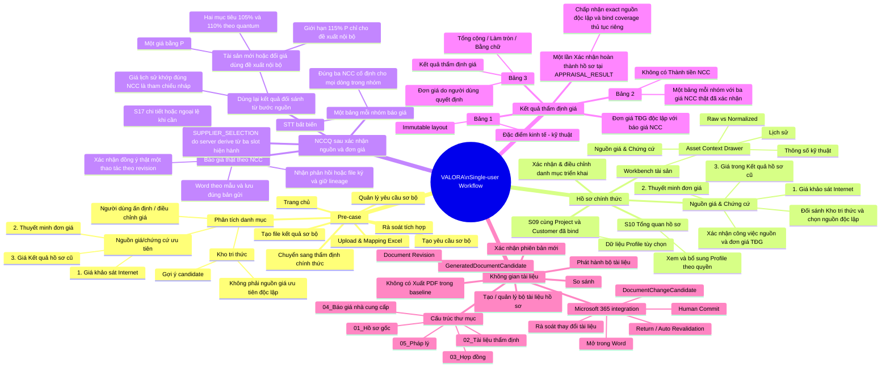

# VALORA v2.3 — User Flow Mindmap

**Trạng thái:** `DESIGN SUPPORT / FLOW MAP`
**Authority:** Bám theo handoff v2.3 + các addendum mới nhất. Nếu mâu thuẫn, business/design authority mới nhất thắng.

**2026-11-28:** [Successor v1.2](../plan/VALORA_252_SUCCESSOR_ADR_DRAFT_v1.2.md) và [OFFICIAL-CASE-PROFILE](VALORA_OFFICIAL_CASE_PROFILE_CONTRACT_V1.md) giải thích thiết kế đích. [CODEX](../../CODEX.md#price-evidence-and-supplier-quotes-certified-scope-vs-approved-design) giữ cap SUPPLIER_QUOTES v1.



## 16 stage canonical

~~~~text
PRELIMINARY_REQUEST → PRELIMINARY_ANALYSIS → PRELIMINARY_READY → OFFICIAL_INTAKE
→ ASSET_REVIEW → ASSET_WORKBENCH → PRICE_EVIDENCE → SUPPLIER_QUOTES
→ SUPPLIER_SELECTION → APPRAISAL_RESULT → DOCUMENT_WORKSPACE → DOCUMENT_SYNC_REVIEW
→ PUBLISHING_PREPARATION → PUBLISHING_EXCEPTION_REVIEW → PUBLISHING_CONFIRMATION → PUBLISHED
~~~~

OFFICIAL_INTAKE giữ cùng Project. Case Overview là orchestration hub, với Profile phục vụ S09/S10 và từng document consumer. S11 chuẩn bị phạm vi tài sản và S12 hoàn thiện KTKT theo exact seal. DOC-Q có thể phục vụ NCCQ theo quyền hẹp riêng. Kho tri thức giúp tìm nguồn và tái sử dụng giá NCC đã xác nhận theo exact revision, giữ history và review.

## Semantic giá

```text
Nguồn ưu tiên xác định giá:
Giá khảo sát Internet
→ Thuyết minh đơn giá
→ Giá trong phần Kết quả của hồ sơ cũ
→ Người dùng quyết định Đơn giá hiện hành / Đơn giá Kết quả

Luồng báo giá NCC đích:
Xác nhận công việc nguồn và đơn giá TĐG → chuẩn bị dự thảo theo nhóm
→ ghi nhận phản hồi thật theo đúng NCC và revision → binding checkpoint do server derive
→ chốt một lần tại Kết quả thẩm định giá → dữ liệu cho tài liệu theo nhóm
Giá đề xuất nội bộ chỉ dùng để chuẩn bị yêu cầu. Báo giá NCC chỉ dùng cho thủ tục và báo cáo.
Nguồn giá độc lập đủ điều kiện chỉ được chấp nhận khi xác nhận hoàn thành hồ sơ.
```

## Working Change Observation / Revision flow

```text
Accepted Revision N
→ Create Working copy
→ user edits/saves in Word
→ automatic provider observation or focus/freshness fallback
→ revalidation + verified read
→ DocumentChangeCandidate
→ Old / V / W
→ recommendation / conflict review
→ explicit human-confirmed command
→ Revision N+1
```

This flow belongs under `DOCUMENT_WORKSPACE → DOCUMENT_SYNC_REVIEW`; it does not add a 17th
canonical case stage. Word Save/provider notification never creates a revision by itself.

## Guardrail

- `Kho tri thức` chỉ gợi ý; không tự ra quyết định giá.
- Giá NCC chỉ phục vụ thủ tục và báo cáo. Nguồn/chứng cứ và đơn giá TĐG có thẩm quyền độc lập.
- Giá NCC lịch sử phục vụ tái tạo báo giá và lineage.
- Người dùng kiểm soát `Đơn giá hiện hành`; mọi thay đổi có history/lineage/audit.
- Không có S14 xác nhận lại giá, màn Kiểm tra hồ sơ riêng hoặc workflow KSCL riêng.
- Kết quả đọc exact group-slot binding từ báo giá thật hiện hành.
- Ba bảng Kết quả thẩm định giá là immutable layout.
- Microsoft 365 quản lý external Working/file/version surface; VALORA quản lý structured business data, snapshots, accepted DocumentRevision/CurrentHead, lineage và audit. OneDrive state never selects authoritative current revision.
